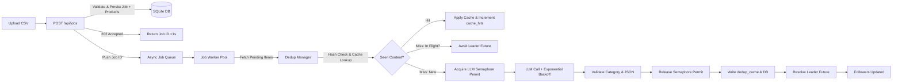

# CatalogIQ — System Design & Architectural Decisions (DESIGN.md)

This document details the architectural choices, trade-offs, scaling strategies, and design decisions behind CatalogIQ.

---

## 1. Architecture: Flow, Parallelism, and Concurrency Choice

### End-to-End Job Lifecycle



### Flow Walkthrough
1. **Ingestion & Acknowledgment (< 1s):** The client sends a batch of products to `POST /api/jobs`. The API validates SKUs and raw titles, inserts the job record and individual product records with `status = 'pending'`, and pushes the `job_id` into an internal `asyncio.Queue`. The API returns HTTP `202 Accepted` with the job payload immediately within milliseconds.
2. **Worker Dispatch:** A background worker task pulls the `job_id` from the queue, marks the job `running`, and fetches pending product records. Products are dispatched through a controlled worker pool.
3. **Deduplication Check:** The content hash is checked against the persistent `dedup_cache` table. If cached, the item is enriched without calling the LLM and `cache_hits` increments. If in-flight, it joins the leader's `asyncio.Future`.
4. **Rate-Controlled LLM Execution:** The leader acquires an `asyncio.Semaphore` permit. It calls the LLM provider. If the call fails or validation fails (invalid JSON or non-whitelisted category), exponential backoff retries up to 3 times (4 attempts total). On terminal failure, product is marked `failed`.
5. **Persistence & Notification:** Results are written to SQLite, persistent cache is updated, and the leader's `asyncio.Future` is resolved, unblocking all follower tasks.

### Concurrency Choice: Why `asyncio` Wins
- **I/O-Bound Profile:** LLM interactions spend >99% of time awaiting HTTP socket I/O (or simulated `asyncio.sleep`). `asyncio` handles thousands of concurrent coroutines with minimal memory footprint compared to OS threads (which allocate MBs of stack space each).
- **Single-Threaded Atomicity:** Because Python `asyncio` is single-threaded and cooperatively scheduled, in-memory structures like `in_flight: dict[str, asyncio.Future]` and high-water mark counters can be checked and updated between `await` calls without OS mutexes or race conditions.
- **Why Threads Were Rejected:** Threading introduces preemptive context switching, requiring `threading.Lock` around cache lookups and metric increments. Multithreaded SQLite access is notoriously prone to `sqlite3.OperationalError: database is locked` without complex connection pooling.
- **Why Processes Were Rejected:** Multiprocessing is suited for CPU-bound tasks. Distributing I/O across processes requires IPC, shared memory managers, or external brokers (Redis) to synchronize the global semaphore and in-flight futures, adding immense unnecessary complexity.

---

## 2. Crash Recovery

### The Scenario
The server abruptly halts (e.g., kill signal, power interruption, kernel panic) halfway through a 10,000-item job where 4,000 items are enriched, 100 failed, 50 were mid-call, and 5,850 are pending.

### The Recovery Mechanism
1. **Durable Per-Item State in SQLite WAL:**
   - Every product's state transition is committed to SQLite with Write-Ahead Logging (`PRAGMA journal_mode=WAL;`).
   - The 4,000 completed items have `status = 'enriched'` and their values stored in `products` and `dedup_cache`.
   - The 100 failed items have `status = 'failed'` with error messages.
2. **Startup Initialization Hook (Lifespan):**
   When the application restarts, before accepting new traffic, it runs a recovery pass:
   ```sql
   -- Find interrupted jobs
   SELECT id FROM jobs WHERE status IN ('queued', 'running');

   -- Reset interrupted mid-flight products back to pending
   UPDATE products SET status = 'pending' WHERE job_id = :job_id AND status = 'in_progress';

   -- Resynchronize counts directly from truth
   UPDATE jobs SET 
       done = (SELECT COUNT(*) FROM products WHERE job_id = :job_id AND status = 'enriched'),
       failed = (SELECT COUNT(*) FROM products WHERE job_id = :job_id AND status = 'failed')
   WHERE id = :job_id;
   ```
3. **Resuming Without Duplicate Work:**
   The background pipeline selects only products where `job_id = :job_id AND status = 'pending'`. The 4,100 already-finished items are completely bypassed. Items that were interrupted mid-flight simply pick up from attempt 0, hitting `dedup_cache` if identical content was already committed by another item.

---

## 3. Scale and Cost: 1 Million Listings / Day with Rate-Limited LLM

Handling $1,000,000$ listings/day equates to an average of $\sim 11.6$ requests/second, with peak bursts likely hitting $50\text{–}100\text{ req/s}$. If the LLM provider has strict rate limits (e.g., 60 RPM or 5,000 RPM) and costs per token, we deploy a 5-layer scaling strategy:

### Strategy & Architecture
1. **Batching Multiple Products per Prompt:**
   - Instead of 1 LLM request per product, batch 10–25 products into a single structured prompt requesting a JSON array of results: `{"results": [{"sku": "...", "clean_title": "..."}, ...]}`.
   - **Benefit:** Reduces HTTP overhead, cuts input token repetition (system prompt shared across 25 items), and reduces required RPM by up to $25\times$ (transforming 1M calls into 40,000 calls).
2. **Persistent Multi-Tier Caching:**
   - E-commerce catalogues exhibit heavy Pareto distribution (20% of catalog items represent 80% of volume). By normalizing listings (`lower()`, whitespace collapse, token sorting) and caching in Redis/PostgreSQL, we intercept $30\%\text{--}50\%$ of queries before they ever reach the LLM.
3. **Leaky Bucket / Token Bucket Distributed Rate Limiter:**
   - Replace the in-process semaphore with a distributed rate limiter (e.g. Redis sliding-window token bucket) matching the LLM provider's tier limits (e.g., TPM and RPM ceilings).
4. **Multi-Provider Fallback & Tiering:**
   - Primary: High-speed, cost-effective provider (e.g., Groq / Llama 3.2 3B).
   - Secondary / Fallback: If primary returns 429 (Rate Limit) or 503 (Overloaded), automatically fall back to Gemini Flash or an alternative provider.
   - For simple listings (clear title, recognizable brand), use smaller/cheaper models; route complex listings to larger models.
5. **Horizontal Worker Pool:**
   - Decouple the ingestion API from workers using an external message queue (SQS, RabbitMQ, or Redis Streams). Workers pull batches based on rate-limit availability.

---