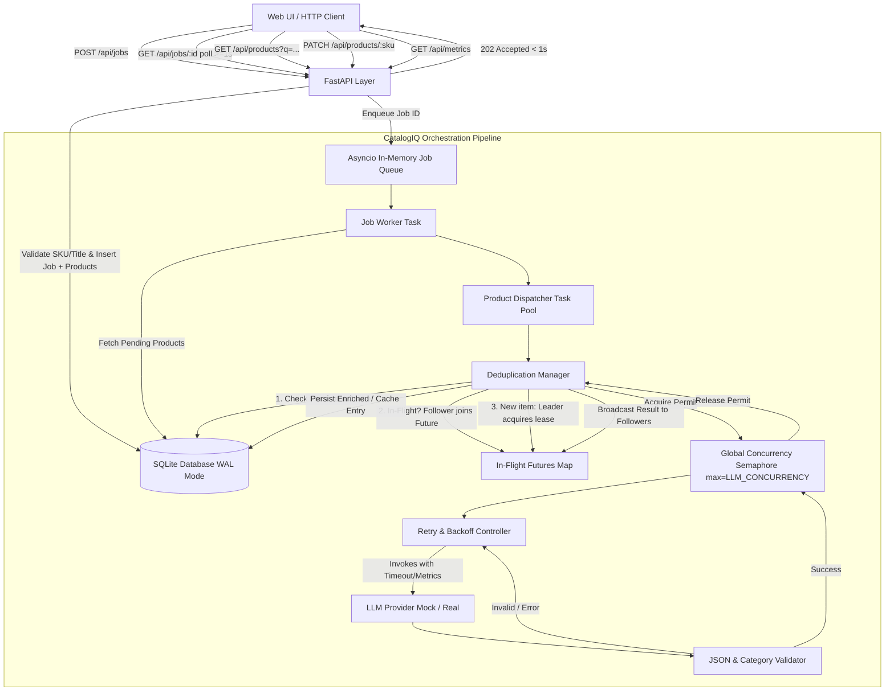
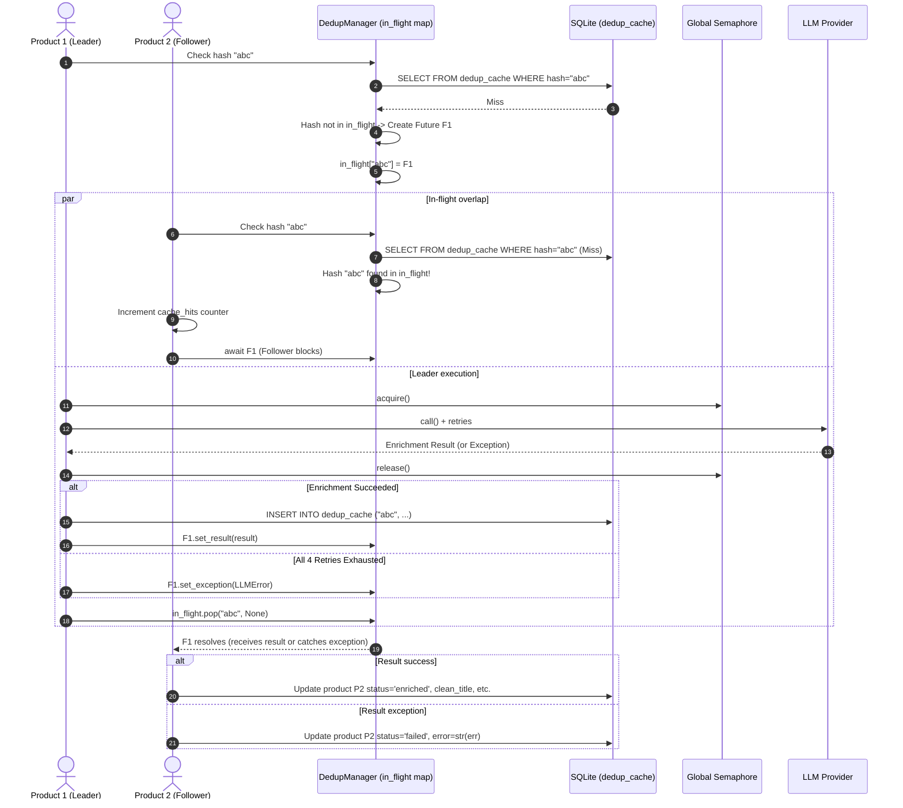

# CatalogIQ — Architecture & Implementation Plan (PLAN.md)

## 1. System Overview & Component Diagram

CatalogIQ is an asynchronous catalogue enrichment pipeline designed to ingest unstandardized seller listings, deduplicate identical content in real time, throttle calls to an LLM provider using a global semaphore, automatically retry transient failures with exponential backoff, survive server crashes, and expose an ultra-fast REST API and responsive web interface.

### End-to-End Component Architecture



---

## 2. Concurrency Choice: Asyncio vs. Threads vs. Processes

### Decision: Python `asyncio` (FastAPI + `asyncio.Queue` + `asyncio.Semaphore`)

### Justification & Evaluation Matrix:

| Dimension | `asyncio` (Chosen) | Multithreading (`threading`) | Multiprocessing (`multiprocessing`) |
| :--- | :--- | :--- | :--- |
| **I/O Profile** | Optimal. LLM network I/O and mock delays (`asyncio.sleep`) yield control cooperatively with virtually zero OS context-switch overhead. | Moderate. OS kernel thread scheduling adds context switching memory overhead (8MB default stack per thread). | Poor fit. Heavyweight process creation for I/O-bound workload; high memory footprint. |
| **Global Semaphore** | Single in-process primitive: `asyncio.Semaphore(LLM_CONCURRENCY)` effortlessly shared across all asynchronous jobs and tasks. | Requires `threading.Semaphore`. Functional, but threads suffer from GIL contention during JSON parsing / regex normalization. | Complex. Requires POSIX semaphore, `multiprocessing.Manager`, or external Redis lock across memory boundaries. |
| **In-Flight Dedup** | Trivial and race-free. Cooperative multitasking guarantees single-threaded atomic operations on Python dictionaries (`in_flight[hash] = future`) without explicit mutex locks around dictionary lookups. | Requires explicit `threading.Lock` / `Condition` variables for every map access to avoid race conditions between leaders and followers. | Extremely complex. Sharing live futures across process boundaries requires custom IPC (pipes/queues/shared memory), defeating simplicity. |
| **SQLite Integration** | Single worker / connection pool or serialized async connection using SQLite WAL mode guarantees high-throughput writes without lock collisions. | Multi-threaded SQLite connections often encounter `sqlite3.OperationalError: database is locked` if threads write concurrently without careful mutexes. | Process-level write contention on a single SQLite file frequently results in database locks and timeout failures under load. |

### Why the alternatives were rejected:
1. **Multiprocessing is rejected** because LLM enrichment is strictly **I/O-bound** (waiting on HTTP sockets or sleep timers), not CPU-bound. Distributing I/O tasks across OS processes incurs severe serialization overhead (pickling state), makes a shared global semaphore across jobs require an external broker or IPC daemon, and makes in-flight futures across processes a nightmare to coordinate.
2. **Threads are rejected** because preemptive OS thread scheduling introduces subtle race conditions in in-flight deduplication and metric counter updates unless protected by coarse-grained mutex locks. Furthermore, SQLite write contention across multiple threads is notoriously prone to `busy` locks unless an explicit write queue is established. `asyncio` provides cooperative scheduling within a single event loop, making state manipulation deterministic, fast, and simple to reason about in an interview.

---

## 3. In-Flight Deduplication Design

### Content Normalization & Content Hash
Two listings are identical if `normalize(raw_title) + " " + normalize(raw_description)` match, where normalization consists of:
1. Handling `None` for optional `raw_description` as empty string `""`.
2. Lowercasing: `.lower()`.
3. Collapsing all whitespace runs (`\s+`) into a single space and trimming leading/trailing whitespace.
4. Computing a deterministic SHA-256 hash:
   $$\text{content\_hash} = \text{SHA256}(\text{normalized\_title} + \text{" "} + \text{normalized\_description})$$

*(Note: If raw_description is empty, normalized text is just `normalized_title`)*.

### In-Flight Data Structure
We maintain an in-memory dictionary in the deduplication manager:
```python
in_flight: dict[str, asyncio.Future] = {}
```

Because `asyncio` runs on a single thread with cooperative multitasking, dictionary reads and assignments between `await` boundaries are **atomic**. No OS-level mutex lock is required to inspect or populate `in_flight`.

### Exact Protocol: Leader vs. Follower



### Protocol Steps:
1. **Cache Check:** Check DB table `dedup_cache` for `content_hash`. If found:
   - Mark product as `enriched`, copy cached fields (`clean_title`, `category`, `brand`, `tags`), increment job `cache_hits`, done.
2. **In-Flight Check:** Check `in_flight` dictionary:
   - **Follower Path:** If `content_hash` is present in `in_flight`:
     - Retrieve existing `fut = in_flight[content_hash]`.
     - Increment job `cache_hits`.
     - `await asyncio.shield(fut)` or wrap in `try/except`:
       - If `fut` completes with a result: apply result to product, mark `enriched` in DB.
       - If `fut` completes with an exception (leader failed after 4 retries): catch exception, mark product `failed` with the leader's error message.
   - **Leader Path:** If `content_hash` is not present:
     - Create a new future: `fut = asyncio.get_running_loop().create_future()`.
     - Register `in_flight[content_hash] = fut`.
     - Execute the pipeline with `asyncio.Semaphore(LLM_CONCURRENCY)` and exponential backoff retry logic.
     - **Resolution:**
       - **On Success:** Insert result into persistent `dedup_cache` DB table. Call `fut.set_result(enrichment_result)`. Mark leader product `enriched`.
       - **On Terminal Failure (4 attempts exhausted):** Call `fut.set_exception(TerminalLLMError)`. Mark leader product `failed`.
     - **Cleanup (`finally` block):** Delete `in_flight.pop(content_hash, None)`. Guaranteed to run even if unexpected cancellations occur.

---

## 4. Crash Recovery Design

If the process crashes or gets killed (e.g. `SIGKILL`, power outage, OS reboot) midway through a 10,000-item job, the database is the source of truth.

### DB State Preservation
- Every product state transition (`pending` $\rightarrow$ `in_progress` $\rightarrow$ `enriched` / `failed`) is updated in SQLite as it completes.
- Finished products (`enriched`, `failed`) and their enriched data are committed to the DB immediately.
- SQLite is configured in **WAL mode** (`PRAGMA journal_mode=WAL;`), ensuring atomic, durable commits that survive sudden process termination.

### Startup Recovery Sequence:
1. **On Application Startup (FastAPI Lifespan handler):**
   Execute recovery queries:
   ```sql
   -- 1. Identify all jobs that were left running or queued when the server died
   SELECT id, status, total, done, failed, cache_hits 
   FROM jobs 
   WHERE status IN ('queued', 'running');
   ```
2. **For each interrupted job:**
   ```sql
   -- 2. Reset abandoned in_progress products back to pending
   UPDATE products 
   SET status = 'pending' 
   WHERE job_id = :job_id AND status = 'in_progress';

   -- 3. Recalculate and synchronize exact counts from ground-truth products table
   SELECT 
       COUNT(CASE WHEN status = 'enriched' THEN 1 END) AS count_done,
       COUNT(CASE WHEN status = 'failed' THEN 1 END) AS count_failed
   FROM products 
   WHERE job_id = :job_id;
   ```
3. Update `jobs.done = count_done` and `jobs.failed = count_failed`.
4. If `count_done + count_failed == total`:
   - Update job `status = 'completed'`, `finished_at = CURRENT_TIMESTAMP`.
5. Otherwise:
   - Set job `status = 'running'`.
   - Re-enqueue the unfinished product IDs into the asyncio processing pipeline.
   - Skip all items already in `status = 'enriched'` or `'failed'`! They are never reprocessed.

---

## 5. Database Schema & SQLite WAL Mode

SQLite is used as an embedded relational database.

### WAL Mode & Concurrency Pragmas
On establishing every connection:
```sql
PRAGMA journal_mode = WAL;          -- Write-Ahead Logging: concurrent readers do not block writers, writers do not block readers
PRAGMA synchronous = NORMAL;        -- Safe in WAL mode, eliminates disk sync bottlenecks
PRAGMA busy_timeout = 5000;         -- Wait up to 5000ms on lock contention rather than throwing SQLITE_BUSY immediately
PRAGMA foreign_keys = ON;           -- Enforce referential integrity
```

### Table Definitions

```sql
-- 1. JOBS TABLE
CREATE TABLE IF NOT EXISTS jobs (
    id TEXT PRIMARY KEY,
    status TEXT NOT NULL CHECK(status IN ('queued', 'running', 'completed', 'failed')),
    total INTEGER NOT NULL DEFAULT 0,
    done INTEGER NOT NULL DEFAULT 0,
    failed INTEGER NOT NULL DEFAULT 0,
    cache_hits INTEGER NOT NULL DEFAULT 0,
    created_at TEXT NOT NULL DEFAULT (datetime('now')),
    started_at TEXT,
    finished_at TEXT
);
CREATE INDEX IF NOT EXISTS idx_jobs_status ON jobs(status);

-- 2. PRODUCTS TABLE
CREATE TABLE IF NOT EXISTS products (
    sku TEXT PRIMARY KEY,
    job_id TEXT NOT NULL,
    raw_title TEXT NOT NULL,
    raw_description TEXT,
    clean_title TEXT,
    category TEXT CHECK(category IS NULL OR category IN (
        'Groceries', 'Beverages', 'Personal Care', 'Household',
        'Electronics', 'Fashion', 'Home & Kitchen', 'Other'
    )),
    brand TEXT,
    tags TEXT, -- JSON array of strings, e.g. '["tag1", "tag2"]'
    status TEXT NOT NULL DEFAULT 'pending' CHECK(status IN ('pending', 'in_progress', 'enriched', 'failed', 'approved')),
    error TEXT,
    attempts INTEGER NOT NULL DEFAULT 0,
    content_hash TEXT NOT NULL,
    updated_at TEXT NOT NULL DEFAULT (datetime('now')),
    FOREIGN KEY(job_id) REFERENCES jobs(id) ON DELETE CASCADE
);
CREATE INDEX IF NOT EXISTS idx_products_job_status ON products(job_id, status);
CREATE INDEX IF NOT EXISTS idx_products_content_hash ON products(content_hash);
CREATE INDEX IF NOT EXISTS idx_products_category ON products(category);
CREATE INDEX IF NOT EXISTS idx_products_clean_title ON products(clean_title);
CREATE INDEX IF NOT EXISTS idx_products_raw_title ON products(raw_title);

-- 3. DEDUP CACHE TABLE (Persistent cache across restarts and across jobs)
CREATE TABLE IF NOT EXISTS dedup_cache (
    content_hash TEXT PRIMARY KEY,
    clean_title TEXT NOT NULL,
    category TEXT NOT NULL,
    brand TEXT,
    tags TEXT NOT NULL, -- JSON array of strings
    created_at TEXT NOT NULL DEFAULT (datetime('now'))
);
```

---

## 6. Trade-offs Rejected & Justifications

### 1. Why not Celery / Redis Queue?
- **Rejected:** Celery + Redis adds two heavyweight external server dependencies, socket configurations, serialization overhead, worker management tooling, and extra operational complexity.
- **Why rejected here:** The project requirement explicitly states "SQLite recommended. Data must survive a restart." Using Python's native `asyncio.Queue` paired with SQLite persistence satisfies background execution, concurrency constraints, and crash recovery with zero external infrastructure. It is lightweight, self-contained, and easy to run and grade on any evaluator's machine without `docker compose`.

### 2. Why not Per-Job Semaphores?
- **Rejected:** `asyncio.Semaphore` instantiated per job (e.g. 5 concurrent calls per job).
- **Why rejected here:** Hard Requirement 3 specifies: *"Global concurrency limit LLM_CONCURRENCY across all jobs, not per-job."* If 10 jobs are submitted concurrently, per-job limits would fire $10 \times 5 = 50$ simultaneous LLM requests, crashing rate limits. A single process-wide singleton `asyncio.Semaphore(LLM_CONCURRENCY)` enforces the strict global boundary regardless of how many jobs run concurrently.

### 3. Why not `asyncio.gather(*[enrich(p) for p in products])` directly?
- **Rejected:** Firing all product tasks into an unbounded `asyncio.gather`.
- **Why rejected here:** For a job with 50,000 products, `asyncio.gather` instantiates 50,000 coroutines into memory simultaneously. Even with a semaphore around the LLM call itself, this causes massive memory bloat, high overhead in the event loop, and complicates graceful pause, cancellation, and progressive batch DB committing. Instead, a fixed worker pool pattern or chunked consumer reads from the queue/DB in controlled slices.

### 4. Why not Threads with `concurrent.futures.ThreadPoolExecutor`?
- **Rejected:** Thread pools for worker execution.
- **Why rejected here:** Python threads share memory, requiring explicit thread locks for in-flight dedup maps and global metrics. Furthermore, concurrent database writes across thread workers in SQLite often trigger `sqlite3.OperationalError: database is locked`. `asyncio` avoids thread locking while keeping I/O multiplexed on a single thread.

---

## 7. Risk Register & Verification Plan

| Risk | Impact | Likelihood | Root Cause | Mitigation & Testing Strategy |
| :--- | :--- | :--- | :--- | :--- |
| **1. Concurrency limit violation under high load** | High | Medium | Leaking permits or semaphore release placed outside `finally` blocks when exceptions occur. | **Mitigation:** Strict `async with semaphore:` context managers. Maintain an atomic gauge `active_calls` alongside `max_concurrent_llm_calls`.<br>**Test:** Launch 50 concurrent items against mock LLM with `LLM_CONCURRENCY=5`. Assert `max_concurrent_llm_calls <= 5` at all times. |
| **2. In-flight follower deadlock or leaked futures** | High | Low | If a leader task crashes or cancels unhandled without resolving the `Future`, followers wait forever. | **Mitigation:** Leader wraps LLM logic in `try ... except ... finally`. `finally` unconditionally calls `in_flight.pop(hash, None)` and resolves future with error if not already set.<br>**Test:** Run test with 10 duplicate items dispatched simultaneously, assert only 1 LLM call occurs, all 10 resolve, and cache hits == 9. |
| **3. SQLite `database is locked` during concurrent writes** | High | Medium | Multiple async tasks writing to SQLite simultaneously without connection concurrency management. | **Mitigation:** Enable `PRAGMA journal_mode = WAL;`, `PRAGMA busy_timeout = 5000;`, and route all DB write transactions through a dedicated async DB queue or synchronized async connection helper.<br>**Test:** Stress test 100 concurrent DB writes from parallel tasks and verify zero `OperationalError`. |
| **4. Retry backoff avalanche under high failure rate** | Medium | Medium | Fixed backoff or aggressive retries tying up the concurrency semaphore and blocking new jobs. | **Mitigation:** Exponential backoff with jitter: $T = 0.2 \times 2^{\text{attempt}} \pm \text{jitter}$. Permits are released during backoff sleep so other products can use the slot!<br>**Test:** Set `MOCK_FAILURE_RATE=0.8`, run 20 items, verify attempts count reaches 4 and product status sets to `failed` without deadlock. |
| **5. State inconsistency after crash** | High | Low | Server killed while job status is `running` and some products are halfway enriched. | **Mitigation:** Startup query resets abandoned `in_progress` products to `pending`, recalculates `done` and `failed` from row states, and resumes.<br>**Test:** Simulate crash by populating DB with half-done job and `in_progress` items, instantiate app, trigger startup recovery, and assert job finishes to completion without re-calling completed items. |

---

## 8. Implementation Steps & Milestones

1. **Step 1:** Architecture plan (PLAN.md), system design documentation (DESIGN.md), and repository scaffolding (current step).
2. **Step 2:** Core database models, SQLite WAL initialization, and migration scripts.
3. **Step 3:** LLM interface, Mock Provider with configurable latency and error rates, JSON/category validation.
4. **Step 4:** Pipeline execution engine: Global Semaphore, In-Flight Deduplication, Exponential Retry, and Metrics tracking.
5. **Step 5:** Background Job Worker and Crash Recovery Lifespan handlers.
6. **Step 6:** FastAPI Endpoints conforming strictly to the API contract.
7. **Step 7:** Comprehensive Unit and Integration Test Suite covering concurrency, deduplication, retries, and crash recovery.
8. **Step 8:** Lightweight, responsive Frontend (HTML, CSS, Vanilla JS) with CSV parsing, debounced search, live polling, and review approval.
9. **Step 9:** Sample realistic dataset (CSV with $\ge 200$ items) and production-grade README documentation.
